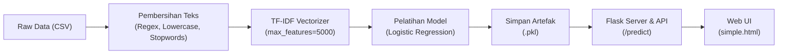

# Fake News Detection System (AOL Machine Learning & MLOps)

Sistem pendeteksi berita bohong (*Fake News*) dan berita asli (*True News*) berbasis **Natural Language Processing (NLP)** dan **Machine Learning**, dilengkapi dengan antarmuka web interaktif serta REST API berbasis **Flask** dan kontainerisasi **Docker**.

---

## 📌 Gambaran Umum Proyek

Penyebaran informasi palsu atau hoaks merupakan tantangan besar dalam konsumsi media digital. Proyek ini bertujuan untuk mengklasifikasikan artikel berita (berbahasa Inggris) secara otomatis ke dalam dua kategori:
- **`True News (0)`**: Berita asli/valid.
- **`Fake News (1)`**: Berita palsu/hoaks.

Model dilatih menggunakan algoritma **Logistic Regression** yang dipadukan dengan representasi teks **TF-IDF (Term Frequency-Inverse Document Frequency)**.

---

## 🛠️ Tech Stack & Library

- **Bahasa Pemrograman**: Python 3.9+
- **Machine Learning & NLP**:
  - `scikit-learn` (Logistic Regression, TF-IDF Vectorizer, Evaluation Metrics)
  - `nltk` (Pembersihan Stopwords)
  - `pandas` & `numpy` (Manipulasi Data)
- **Web Framework & API**: `Flask`
- **Frontend**: HTML5, CSS3, Vanilla JavaScript (Fetch API)
- **Containerization & Deployment**: `Docker`, `Docker Compose`

---

## 📂 Struktur Direktori Proyek

```text
AOL/
├── rawData/
│   ├── .gitkeep                 # Menjaga struktur folder tetap ada di Git
│   ├── Fake.csv                 # Dataset berita palsu (~62.8 MB) [Diabaikan di Git]
│   └── True.csv                 # Dataset berita valid (~53.6 MB) [Diabaikan di Git]
├── templates/
│   └── simple.html              # Antarmuka web pengguna (UI)
├── app.py                       # Backend server Flask & endpoint /predict
├── train.py                     # Pipeline pelatihan, vectorizer, dan evaluasi model
├── Dockerfile                   # Spesifikasi container Docker
├── docker-compose.yml           # Konfigurasi orkestrasi container
├── requirements.txt             # Daftar dependensi Python
├── model_fakeTrue_news.pkl      # Artefak model Logistic Regression (tersimpan)
├── vectorizer.pkl               # Artefak TF-IDF Vectorizer (tersimpan)
├── Demo.mp4                     # Video demonstrasi proyek [Diabaikan di Git]
├── .gitignore                   # Konfigurasi file yang diabaikan Git
└── README.md                    # Dokumentasi lengkap proyek
```

---

## 📊 Dataset

Dataset yang digunakan bersumber dari dataset standar deteksi berita (*ISOT Fake News Dataset*):
- **`True.csv`**: Kumpulan artikel berita terverifikasi (umumnya bersumber dari kantor berita Reuters).
- **`Fake.csv`**: Kumpulan artikel berita hoaks/palsu dari berbagai sumber online tidak kredibel.
- **Struktur Kolom**:
  - `title`: Judul artikel berita.
  - `text`: Isi lengkap artikel berita.
  - `subject`: Kategori/topik berita (misal: *politicsNews*, *worldnews*).
  - `date`: Tanggal publikasi berita.

> **Catatan Penyimpanan Dataset**:
> Karena ukuran kedua file CSV melebihi **115 MB**, file dataset diabaikan oleh Git via `.gitignore` untuk mencegah batas ukuran file GitHub (maks. 100 MB). Jika baru melakukan `git clone`, pastikan Anda meletakkan file `True.csv` dan `Fake.csv` ke dalam folder `rawData/`.

---

## ⚙️ Alur Kerja Sistem (Pipeline)



1. **Text Preprocessing**:
   - Konversi teks ke huruf kecil (*lowercase*).
   - Menghilangkan tanda kurung siku, URL, tag HTML, tanda baca, karakter newline, dan angka.
   - Menghapus kata umum berbahasa Inggris (*stopwords*) menggunakan modul NLTK.
2. **Feature Extraction**:
   - Mengubah teks menjadi representasi numerik menggunakan `TfidfVectorizer` dengan 5.000 fitur kata terpenting.
3. **Model Training**:
   - Data dibagi menjadi 80% data latih (*training set*) dan 20% data uji (*test set*).
   - Melatih model `LogisticRegression` pada data latih.
4. **Evaluasi & Simpan**:
   - Mengukur performa menggunakan akurasi dan *classification report* (Precision, Recall, F1-Score).
   - Menyimpan model ke `model_fakeTrue_news.pkl` dan vectorizer ke `vectorizer.pkl`.

---

## 🚀 Panduan Menjalankan Proyek

### Cara 1: Menggunakan Lingkungan Python Lokal

1. **Clone Repositori**:
   ```bash
   git clone <url-repository-anda>
   cd AOL
   ```

2. **Buat & Aktifkan Virtual Environment**:
   ```bash
   # Windows
   python -m venv venv
   venv\Scripts\activate

   # macOS / Linux
   python3 -m venv venv
   source venv/bin/activate
   ```

3. **Install Dependensi**:
   ```bash
   pip install -r requirements.txt
   ```

4. **Latih Model (Opsional jika ingin melatih ulang)**:
   ```bash
   python train.py
   ```
   *Langkah ini akan menghasilkan file `model_fakeTrue_news.pkl` dan `vectorizer.pkl`.*

5. **Jalankan Web Server Flask**:
   ```bash
   python app.py
   ```
   Buka peramban (browser) dan akses:
   👉 **`http://localhost:5000`**

---

### Cara 2: Menggunakan Docker & Docker Compose

Pastikan Docker Desktop sudah terpasang dan berjalan di komputer Anda.

1. **Build dan Jalankan Container**:
   ```bash
   docker compose up --build
   ```
2. **Akses Aplikasi**:
   Buka browser di **`http://localhost:5000`**.
3. **Menghentikan Container**:
   ```bash
   docker compose down
   ```

---

## 📡 Dokumentasi Endpoint REST API

### 1. Halaman Web (UI)
* **URL**: `/`
* **Method**: `GET`
* **Keterangan**: Menampilkan antarmuka formulir deteksi berita berbasis HTML.

---

### 2. Prediksi Berita
* **URL**: `/predict`
* **Method**: `POST`
* **Header**: `Content-Type: application/json`

#### Contoh Request Body (JSON):
```json
{
  "text": "The government announced a new economic stimulus package to support small businesses nationwide."
}
```

#### Contoh Response Sukses (`200 OK`):
```json
{
  "status": "success",
  "prediction": "True News (Berita asli)"
}
```
*atau untuk berita terdeteksi hoaks:*
```json
{
  "status": "success",
  "prediction": "Fake News (Berita hoax)"
}
```

#### Contoh Response Error (`400 Bad Request`):
```json
{
  "error": "Masukkan teks berita dengan key \"text\""
}
```

---

## 🔍 Catatan Evaluasi & Rekomendasi Teknis

1. **Konsistensi Preprocessing**:
   Pastikan fungsi `clean_text` pada `app.py` memiliki tahapan yang identik dengan `train.py` (terutama penghapusan *stopwords*), agar distribusi token input pengguna saat inferensi sama persis dengan data saat pelatihan.
2. **Pencegahan Data Leakage**:
   Pada dataset berita asli (*True News*), banyak artikel diawali dengan label kantor berita seperti `WASHINGTON (Reuters) -`. Disarankan untuk membersihkan atribusi penerbit agar model tidak hanya menghafal kata "reuters" untuk memutuskan keaslian berita.
3. **Optimalisasi Docker**:
   Agar waktu *startup* container lebih cepat, pisahkan proses *training* dan *serving* sehingga container tidak perlu mengulang proses `train.py` setiap kali dijalankan jika artefak model `.pkl` sudah tersedia.
